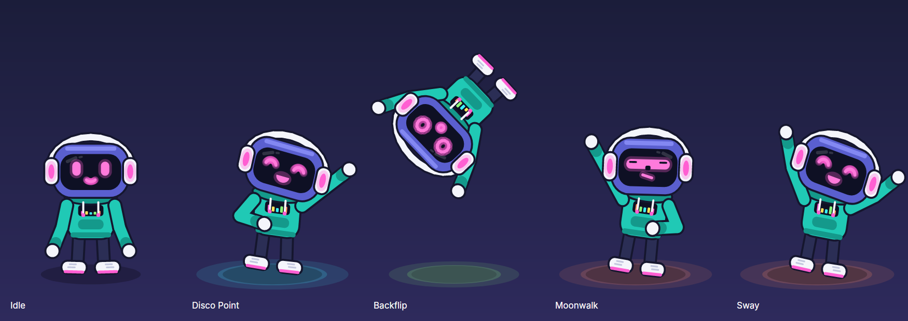

# DeskDancer

A little mate that lives on your desktop and dances. It stands on your taskbar, wanders
about, sits down, naps, and breaks into dance moves on its own or whenever you ask.
Written in C# with [Avalonia](https://avaloniaui.net/); runs on Windows and Linux.


The mate you start with is **Mochi**. It is an image pack, animated from a single photo.
Standing, it blinks, flicks an ear and tilts its head; it waddles from foot to foot when
it wanders, puts on a happy face and flaps its ears for every dance move, and has two
dances of its own, Bunny Hop and Ear Wave. Its ears swing on springs, so they trail and
flop as it moves. How it was made, and how to change it, is in
[characters/mochi/_source](characters/mochi/_source/README.md).



**Remix** is a DJ robot drawn entirely in code, with arms, legs and a face of its own.
Switch between the two under **Character** in the menu. You can also drop in a folder of
your own images and it becomes a character that walks and dances too: see
[characters/README.md](characters/README.md).


**Lyra**, a bard with a lute, is an image pack animated from a single drawing by
@thaissingarts. She blinks, her long hair sways and swings after her when she moves, and
now and then she waves. She walks on her own two feet, sits down on her heels, sings
along to every dance move and has three dances of her own: Serenade, Hair Flip and Wave
Hello. Pick her under **Character**, or start with `--character lyra`. How she was made
is in [characters/lyra/_source](characters/lyra/_source/README.md).

## Run it

You need the [.NET 10 SDK](https://dotnet.microsoft.com/download) to build. The result
is a single self-contained program that needs nothing installed to run.

Windows (PowerShell):

```powershell
.\publish.ps1
dist\win-x64\DeskDancer.exe
```

Linux:

```bash
./publish.sh
dist/linux-x64/DeskDancer
```

Either script takes a runtime name if you want to build for the other system, for
example `./publish.sh win-x64`. Keep the `characters` folder next to the program: Mochi
lives in it, and without it the mate is Remix.

Every push is also built by GitHub Actions. If you would rather not install .NET, open
the latest run under the repository's **Actions** tab and download `DeskDancer-win-x64`
or `DeskDancer-linux-x64` from its artifacts.

To run straight from source instead: `dotnet run --project src/DeskDancer`.

## Using it

| Do this | And the mate |
| --- | --- |
| Double-click | starts a random four-move dance (double-click again to stop) |
| Click | does a happy hop |
| Drag | gets picked up; let go and it drops, throw it and it flies |
| Right-click | opens the menu |

The right-click menu has everything else:

- **Dance move / Routine**: pick one of 15 moves or a choreographed routine.
- **Dance party**: every mate on screen dances non-stop, in sync.
- **Tempo**: 80 to 160 BPM. All moves are written against the beat, so they follow it.
- **Sit down / Take a nap**, and switches for wandering, dancing on its own, falling
  when dropped, and the notes-and-sparkles effects.
- **Character / Size / Add another mate**: switch character, resize from 50% to 300%,
  or put several mates on screen at once.
- **Always on top**, **Click through empty space**, **Quit**.

### The moves

Bounce, Sway, Disco Point, Side Step, Shuffle, Wiggle, Headbang, Pop & Lock, Star Jumps,
Twirl, Tornado, Backflip, Cartwheel, Moonwalk and Strut. The last three travel across
the screen. Routines chain them: Disco Fever, Street, Acrobat and Chill.

Every move works on every character. Remix also moves its arms, legs, head and face;
image characters are bounced, leaned, spun and flipped as a whole.

## Platform notes

**Windows 10 and 11.** Nothing to set up.

**Linux.** Needs an X11 session, or Wayland with XWayland (the default on GNOME and
KDE), and a compositing window manager for the transparent background. Without a
compositor the mate appears on a black rectangle.

**Clicking through.** The mate lives in a small transparent window. So that the empty
part of it does not block what is underneath, only the area around the character
takes mouse input. On Windows this is done while the mate is standing, sitting or
walking; during a dance the whole window (roughly 1.7 x 2 character heights) takes
clicks. Turn the feature off in the menu if it misbehaves with your setup.

Settings are remembered in `%APPDATA%\DeskDancer` on Windows and `~/.config/DeskDancer`
on Linux, along with a log file if something goes wrong. That includes which character
each mate is, so a mate you already have stays as it was when the program is updated.

## Command line

```
--character <id>        Start with this character: "builtin" for Remix, or a folder
                        name such as "mochi"
--characters <folder>   Also look for character folders here
--fresh                 Ignore saved settings for this run
--smoke-test            Run every feature for a few seconds, exit 0 on success
--render-test <dir>     Render every dance move to PNG contact sheets
--export-sample <dir>   Write the built-in character out as an example image pack
```

## How it is put together

```
src/DeskDancer/
  Engine/       Behaviour and choreography. No UI code in here.
    DanceMoves.cs   Each move is a function from "beats elapsed" to a pose
    MateBrain.cs    Idle / walk / sit / sleep / dance / drag / fall state machine
    Conductor.cs    Beat clock and the shared session behind the dance party
  Characters/   Remix (drawn in code) and the loader for image packs
  Ui/           The transparent window, its menu and the renderer
  Platform/     Click-through for Windows and X11; giving freed memory back on Linux
  Tools/        Smoke test, contact sheets and the example pack exporter
characters/     Character packs that ship with the app
```

An image pack is not read all at once. Its idle animation is read when the character is
picked, which at start-up happens on another thread while the window is being put
together. Each of its other animations is read the first time the mate needs it, and
dropped again after a minute out of use. A mate that mostly stands about holds little
more than its idle frames.

The GitHub Actions workflow builds both systems and runs the smoke test on each. The
smoke test starts the real app and drives it: dancing, a two-mate party, the menu,
dragging and throwing, with Mochi, Remix and a second image pack each taking a turn. It
checks that a pack's animations arrive when a mate first needs them and come back after
being dropped, and that every animation of every pack can be read. On Windows it also
reads pixels back off the screen to confirm that the window is see-through and the
character is visible, checks that clicks pass through the empty part of the window, and
saves pictures of the desktop as artifacts.

One thing to know when building: Avalonia's build step sends anonymous usage data to
its vendor. The publish scripts and the workflow switch that off with
`AVALONIA_TELEMETRY_OPTOUT=1`; set it yourself if you build some other way.
