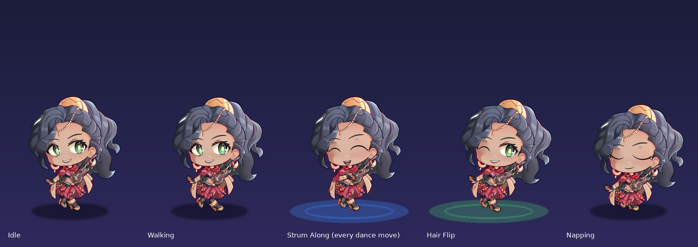
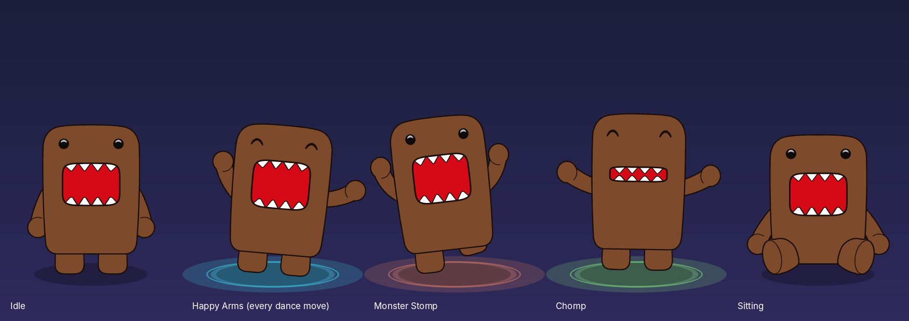
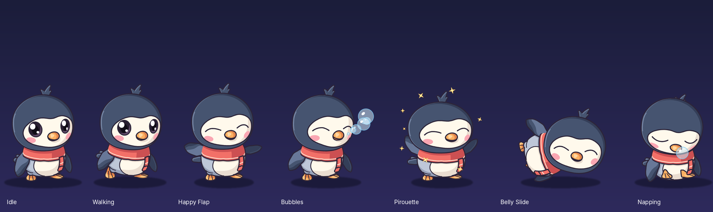
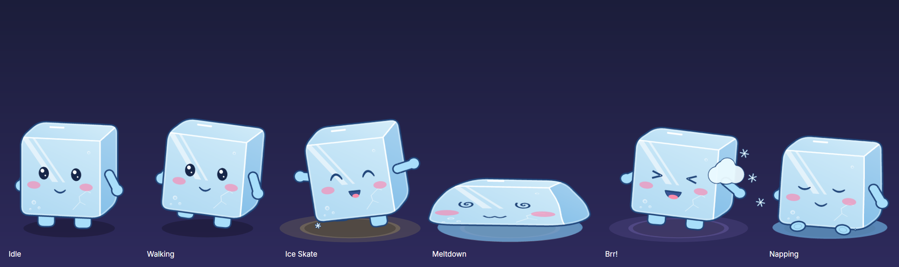
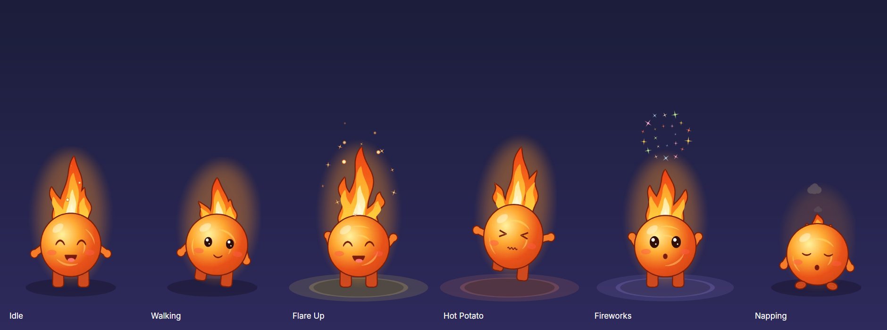
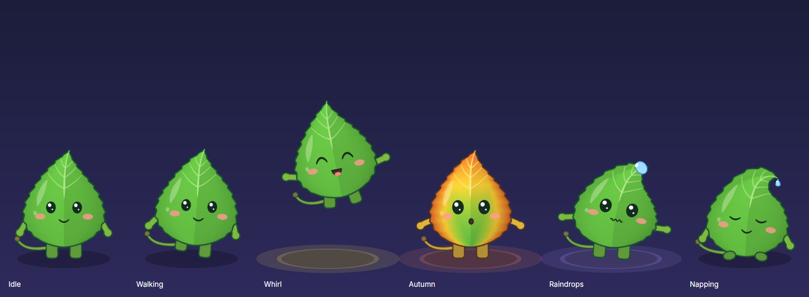

# DeskDancer

A little mate that lives on your desktop and dances. It stands on your taskbar, wanders
about, sits down, naps, and breaks into dance moves on its own or whenever you ask.
Written in C# with [Avalonia](https://avaloniaui.net/); runs on Windows, Linux and macOS.


The mate you start with is **Mochi**. It is an image pack, animated from a single photo.
Standing, it blinks, flicks an ear and tilts its head; it waddles from foot to foot when
it wanders, puts on a happy face and flaps its ears for every dance move, and has two
dances of its own, Bunny Hop and Ear Wave. Its ears swing on springs, so they trail and
flop as it moves. How it was made, and how to change it, is in
[characters/mochi/_source](characters/mochi/_source/README.md).


**Remix** is a DJ robot drawn entirely in code, with arms, legs and a face of its own.



**Lyra**, a bard with a lute, is an image pack animated from a single drawing by
@thaissingarts. She blinks, her long hair sways and swings after her when she moves, and
now and then she waves. She walks on her own two feet and sits down on her heels. When
the music starts she plays her lute, strumming and singing along to every dance move,
and she has three dances of her own: Serenade, Hair Flip and Wave Hello. Pick her under
**Character**, or start with `--character lyra`. How she was made is in
[characters/lyra/_source](characters/lyra/_source/README.md).



**Domo** is an image pack with no picture behind it: a script draws every frame, so his
arms, legs, eyes and mouth all move. He toddles when he wanders, sits down with his legs
out in front of him, snaps his teeth, and has two dances of his own, Chomp and Monster
Stomp. He also has three actions, things he does now and then that are not dances: Bubble
Tea, where he brings out a cup, shakes it and drinks it through a straw down to the last
pearl; Fart; and Apple Tree, where an apple tree comes up out of thin air beside him,
grows one apple and drops it at his feet, and he runs for it, one way across the screen
and back the other, with the apple rolling after him until it lands in his mouth.
How he is drawn, and how to change him, is in
[characters/domo/_source](characters/domo/_source/README.md). Domo is NHK's mascot; this
is a fan drawing, and NHK had no part in it.


**Plush Domo** is the same Domo made of fleece, with felt teeth and glossy beads for
eyes. He is still a flat drawing, and the fleece is made by a script, not taken from a
photo. He does everything Domo does, Bubble Tea, Fart and Apple Tree included, because he is drawn
from the same shapes and the same clips by a different painter:
[characters/domo-plush/_source](characters/domo-plush/_source/README.md).



**Pebble** is a baby penguin, an original character drawn by a script: a big round head
with a dark cap and a tuft of down on top, a cream face, large shiny eyes, pink cheeks and
a little peach beak, a round grey body with a cream tummy, a coral knitted scarf, and
stubby feet. Its head and body are two balls with the face, the tummy and the scarf placed
on them as on a globe, so it can look about, nod and turn right round. Standing, it blinks,
glances round at you, shakes a flipper, wags its tail and puffs out its chest. It waddles
on webbed feet that stay where they are put on the floor, sits with its feet out in front,
and naps with a bubble at its beak. It has three dances of its own: **Bubbles**, when it
blows a stream of bubbles and hops as they burst; **Pirouette**, twice round on one foot;
and **Belly Slide**, down on its front and off across the floor. It also has an action,
**Take a Bow**. Pick it under **Character**, or start with `--character pebble`. How it is
drawn, and how to change it, is in [characters/pebble/_source](characters/pebble/_source/README.md).
Pebble takes the place of the Piplup pack that came with 1.1: a mate that was Piplup is
Pebble now.


**Sprig**, a little swordsman in a green cap, is an image pack animated from a single
commissioned drawing. He blinks, the long tail of his cap swings and flops after him when
he moves, and now and then he gives his sword a flourish. He walks on his own two feet and
kneels with the point of his sword in the ground. He punches the sword up on every beat of
the built-in dance moves, and his special move is the **Spin Attack**: he crouches while
the blade charges up with light, spins round twice leaving a ring of light behind it, and
comes out of it with the sword held high in a shower of sparks. Pick him under
**Character**, or start with `--character sprig`. How he was made is in
[characters/sprig/_source](characters/sprig/_source/README.md). Sprig is fan art of a
Nintendo character, and Nintendo had no part in it.



**Kori** is an ice cube with stubby arms and legs, an original character drawn entirely by
a script, like Domo. It is a real cube turned in three dimensions, so the light moves across
its faces as it turns, with glints, a crack and trapped bubbles in the ice. It blinks,
shivers, drips meltwater, waddles about and sits on a little puddle. It has three dances of
its own: **Ice Skate**, gliding on one foot and spinning on the spot; **Meltdown**, melting
into a puddle and freezing back up with a sparkle; and **Brr!**, shivering until it sneezes
out a puff of frost. Pick it under **Character**, or start with `--character kori`. How it
is drawn, and how to change it, is in [characters/kori/_source](characters/kori/_source/README.md).



**Ember** is a ball of fire with a flame on its head, another original character drawn by a
script. Its flame flickers all the time, leans back when Ember moves and stays upright when
it leans, and burns down to a little flicker with a wisp of smoke when it naps. It glows,
lets embers drift up, waddles about on stubby legs and has three dances of its own:
**Flare Up**, when its flame roars up into a column in a burst of sparks; **Hot Potato**,
hopping from foot to foot on a floor too hot to stand on; and **Fireworks**, when it sends
a spark up out of its flame to burst in the sky. Pick it under **Character**, or start with
`--character ember`. How it is drawn is in
[characters/ember/_source](characters/ember/_source/README.md).



**Aspen** is a leaf, a third original character drawn by a script: a green leaf with a
toothed edge and a pointed tip, on stubby legs, with its stalk sticking out behind like a
tail. It bends the way a leaf does, so it stirs in the breeze, bows right over when a gust
catches it, and its tip flops when it lands. It is a sheet folded along its midrib and
turned in three dimensions, so when it spins you see it edge on and then its pale, veined
back. It has three dances of its own: **Whirl**, when the wind takes it up, spinning, and
it drifts back down swinging from side to side as leaves do; **Autumn**, when it turns
gold, orange and red from its edge inwards, shows off in a shower of falling leaves and
shakes itself green again; and **Raindrops**, when drops land on its tip one after another
until a big one bows it over and it flicks it off. Sitting, it watches a ladybird climb up
it, and when it naps a drop of dew gathers on its drooping tip. Pick it under
**Character**, or start with `--character aspen`. How it is drawn is in
[characters/aspen/_source](characters/aspen/_source/README.md).

Switch between them under **Character** in the menu. You can also drop in a folder of
your own images and it becomes a character that walks and dances too: see
[characters/README.md](characters/README.md).

## Run it

Ready-made downloads for Windows, Linux, macOS and Android are on the
[Releases](https://github.com/FriendlyUser/deskdancer/releases) page:

| System | Download | Then |
| --- | --- | --- |
| Windows 10 and 11 | `DeskDancer-win-x64-Setup.exe` | Run it. It installs DeskDancer for you alone, with no administrator rights, puts it on the Start menu and the desktop, and starts it. |
| Windows, without installing | `DeskDancer-win-x64-Portable.zip` | Unzip it anywhere and run `DeskDancer.exe`. |
| Linux | `DeskDancer-linux-x64.AppImage` | Make it executable (`chmod +x`) and run it. |
| macOS, Apple silicon | `DeskDancer-osx-arm64-Portable.zip` | Unzip it, move `DeskDancer.app` to Applications and open it. |
| macOS, Intel | `DeskDancer-osx-x64-Portable.zip` | The same. |
| Android 8 or later | `DeskDancer-<version>-android.apk` | See [Platform notes](#platform-notes). |

Every one of these but the Android one keeps itself up to date from then on: see
[Updates](#updates). The other files on a release, ending in `.nupkg` and `.json`, are what
installed copies fetch to do that, and nobody needs to download them by hand.
[Platform notes](#platform-notes) has what each system asks the first time.

To build it yourself, you need the [.NET 10 SDK](https://dotnet.microsoft.com/download).
The result is a single self-contained program that needs nothing installed to run. A copy
you build does not update itself.

Windows (PowerShell):

```powershell
.\publish.ps1
dist\win-x64\DeskDancer.exe
```

Linux:

```bash
./publish.sh
dist/linux-x64/DeskDancer
```

macOS:

```bash
./publish.sh
open dist/osx-arm64/DeskDancer.app
```

On a Mac the script builds for the machine it is run on (`osx-arm64` on Apple silicon,
`osx-x64` on Intel) and wraps the result up as an app.

Either script takes a runtime name if you want to build for another system, for example
`./publish.sh win-x64`. Keep the `characters` folder next to the program: Mochi lives in
it, and without it the mate is Remix. In the Mac app it is inside the app itself.

Every push is also built by GitHub Actions. If you would rather not install .NET, open
the latest run under the repository's **Actions** tab and download one of its artifacts:
`DeskDancer-win-x64`, `DeskDancer-linux-x64`, `DeskDancer-osx-arm64` (Macs with Apple
silicon) or `DeskDancer-osx-x64` (Intel Macs).

To run straight from source instead: `dotnet run --project src/DeskDancer`.

## Using it

| Do this | And the mate |
| --- | --- |
| Double-click | starts a random four-move dance (double-click again to stop) |
| Click | does a happy hop |
| Drag | gets picked up; let go and it drops, throw it and it flies |
| Right-click | opens the menu |

The right-click menu has everything else:

- **Dance move / Routine**: pick one of 15 moves or a choreographed routine.
- **Moves to use**: untick the moves you don't care for, built-in ones and the
  character's own dances and actions. See [Switching moves off](#switching-moves-off) below.
- **Dance party**: every mate on screen dances non-stop, in sync.
- **Tempo**: 80 to 160 BPM. All moves are written against the beat, so they follow it.
- **Actions**: for a character that has some, such as Domo's Bubble Tea, Fart and Apple
  Tree, have it do one. See [Actions](#actions) below.
- **Sit down / Take a nap**, and switches for wandering, dancing on its own, doing its
  actions on its own, falling when dropped, and the notes-and-sparkles effects.
- **Character / Size / Add another mate**: switch character, resize from 50% to 300%,
  or put several mates on screen at once. With more than one, they bump into each other
  and meet up to dance: see [More than one mate](#more-than-one-mate) below.
- **Always on top**, **Click through empty space**, **Settings...**, **Quit**.

### Settings

**Settings...** in the right-click menu opens a window with the things most people want to
change, on one page. Every change takes effect straight away.

| Card | What is on it |
| --- | --- |
| **This mate** | The character and the size of the mate whose menu you opened it from. |
| **What the mates do** | Wander around, dance on its own, do actions on its own, bump into each other, meet up and dance together, fall when dropped, notes and sparkles, and the tempo. |
| **On the desktop** | Always on top, and click through empty space. |
| **Your characters** | The folder characters of your own are kept in, with **Open folder**, **Copy path**, **Change...** to keep them somewhere else, **Use the usual folder** to go back, and **Reload characters**. |
| **Saving** | **Save changes as I make them** (on to begin with; switched off, changes last until you quit unless you press **Save now**), **Reset to defaults** (the tempo, the switches and the moves; your mates and characters are kept), and where the settings file is, with **Open folder**. |
| **Updates** | Which version this is, **Update automatically** (on to begin with), **Check now**, **Restart to update** once a newer version has been downloaded, and **Downloads page**. See [Updates](#updates). |

A folder chosen with **Change...** is looked in first. The usual folder is still looked in
after it, and so are the characters that come with DeskDancer, so nothing you already had
goes missing.

### Updates

DeskDancer keeps itself up to date. A copy from one of the [downloads](#run-it) looks at
this repository's [releases](https://github.com/FriendlyUser/deskdancer/releases) half a
minute after it starts, and every six hours after that, since a mate can be left on the
desktop for weeks. When there is a newer version it downloads it in the background and
waits for a quiet moment: no mate being carried, falling, dancing or in the middle of an
action, no menu or Settings window open, and no change to the settings still unsaved. Then
the mates go away for a second or two, the new version takes the place of the old one, and
they come back. Your settings and your own characters are kept somewhere else and are not
touched.

The **Updates** card on the [Settings](#settings) window says which version you have and
how this is going. Switching **Update automatically** off stops all of it: DeskDancer then
looks only when you press **Check now**, and a version it finds goes in when you press
**Restart to update**, or the next time you start DeskDancer. While a version is waiting,
the mate's menu has **Restart to update to ...** as well.

The updating is done by [Velopack](https://velopack.io). It asks GitHub for the list of
releases and downloads the package for your system from there, and that is all it does on
the network: Velopack collects nothing about you. Only a copy that Velopack put in can
replace itself, which is every download above. One you built yourself, or a download of
version 1.0.0 from before any of this, says on the Updates card that it cannot, and has a
button for the downloads page. The Android app does not update itself either.

Two things to know:

- An update replaces the program and everything that came with it, the `characters` folder
  next to it included. Characters of your own belong in your own characters folder, which
  the Settings window shows and opens: one you added next to the program is gone after the
  next update.
- The program has to be somewhere it can be replaced. A Mac app should be moved out of
  Downloads, to Applications or anywhere else, before it is first opened, because macOS
  may show an app it has just downloaded a read-only copy of itself. A Linux AppImage
  should be kept in a folder of yours; in a folder only an administrator can write to, it
  asks for the password every time it updates.

### The floor

The mates stand on a floor, and nothing takes one below it. Carry a mate down past it and
it stays on the floor, sliding along under your hand; throw it down and it lands there;
and no dance, action or knock from another mate puts its feet under it. The floor itself
is not drawn.

To begin with it is the bottom of the screen's work area, so the mates stand on the
taskbar or the Dock. There is nothing for it in the menu or on the Settings window. It has
two entries in `settings.json` (see below), to be edited while the app is closed:

```json
"Floor": true,
"FloorHeight": 0
```

`FloorHeight` is how far above the bottom of the work area the floor is, in pixels before
any display scaling. At 200 the mates stand 200 pixels up the screen, on nothing you can
see, and that is where they land when dropped. It is never so high that a mate would not
fit on the screen, and anything below 0 counts as 0. `"Floor": false` takes the floor away
again, and `FloorHeight` with it: a mate can then be carried below where it stands, as it
could before there was one, and comes back up when you let go. **Reset to defaults**
leaves both as they are.

On Android the settings file is in the app's own storage, where it cannot be edited
without developer tools, so there the floor is always on and is the top of the navigation
bar.

### More than one mate

Put a second mate on the screen with **Add another mate**, and they take notice of each
other.

**They meet up and dance.** A mate that sees another a little way off walks over to it, and
now and then one sets off across the screen to find another. When two are side by side they
turn to each other, say hello with a hop and a heart each, and dance the same five moves in
step, with confetti to start. Any other mate that comes by joins in. Afterwards they have had
enough company for the best part of a minute, and go back to what they were doing. You can
start one yourself by carrying a mate over and putting it down next to another.

**They bump into each other.**

| Do this | And |
| --- | --- |
| Throw a mate at another | it bounces off, and the one it hits is knocked flying, or shoved along the floor if it was a gentle throw |
| Drop a mate on another | it bounces off the other's head, which squashes |
| Carry a mate into another | the other is pushed along the floor |
| Swing a carried mate at another | the other is batted away |

Two mates that end up standing on the same spot step apart. A mate that is walking
somewhere, or that a dance or an action is taking across the screen, goes past the others
as if behind them, so nobody gets stuck on the wrong side of anybody else.

Both have a switch, in the right-click menu when there is more than one mate and on the
Settings window: **Bump into each other** and **Meet up and dance together**. **Dance
party** is still there for everyone dancing non-stop, wherever they are.

On Android there is one mate, so none of this applies there.

### The moves

Bounce, Sway, Disco Point, Side Step, Shuffle, Wiggle, Headbang, Pop & Lock, Star Jumps,
Twirl, Tornado, Backflip, Cartwheel, Moonwalk and Strut. The last three travel across
the screen. Routines chain them: Disco Fever, Street, Acrobat and Chill.

Every move works on every character. Remix also moves its arms, legs, head and face;
image characters are bounced, leaned, spun and flipped as a whole.

### Actions

Some characters can do things that are not dances: Domo and Plush Domo can have a bubble
tea (about 8½ seconds), fart (about 7) and be chased by an apple (about 17), and Pebble can
take a bow (4). An action is played once through at its own speed, with no music notes and
no dance floor under the mate, and then the mate goes back to standing about. Pick one from
**Actions** in the right-click menu; a mate also does one of its actions now and then on
its own, unless **Do actions on its own** is unticked. Picking it up, or telling it to sit,
nap or dance, cuts an action short, and a **Dance party** waits for the mate to finish one
before it joins in.

An action can take the mate somewhere. In Apple Tree, Domo runs about two and three
quarter heights one way and nearly four and a half back, and ends up to one side of where
he started. Where the screen leaves no room for that, the whole action is played the other
way round, tree and all; and if there is no room either way, he runs on the spot against
the edge of the screen for the part that does not fit.

A character of your own can have actions too: see
[characters/README.md](characters/README.md#adding-animations).

### Switching moves off

Right-click the mate and open **Moves to use**. It lists the character's own dances and
actions first, then the 15 built-in moves, each ticked while it is in use. Untick the ones you don't care
for; the menu stays open, so you can go down the list in one go, and **Switch them all back
on** undoes the lot. A move that is switched off is left out everywhere:

- the **Dance move** list,
- the dance a double-click starts, and the dances a mate does on its own,
- the **Dance party**, even one that is already going,
- **Routines**, which play without it, and disappear from the menu if that leaves nothing.

An action that is switched off is left out of the **Actions** menu and is never done unasked.

The built-in moves are shared by every mate. A character's own dances and actions are
switched off for that character alone, so switching off Domo's Fart leaves Plush Domo's
alone. One built-in
move always stays on, so there is always something to dance: the last one cannot be
unticked.

The choice is saved with the other settings (see below), in `settings.json` under
`DisabledMoves`. You can also edit it there while the app is closed: a built-in move is
listed by its id, and a character's own dance or action as the character's folder name and
the clip's name, joined by a slash.

```json
"DisabledMoves": ["backflip", "cartwheel", "tornado", "domo/action_fart", "sprig/dance_spin_attack"]
```

The ids of the built-in moves are `bounce`, `sway`, `disco`, `sidestep`, `shuffle`,
`wiggle`, `headbang`, `poplock`, `starjump`, `twirl`, `tornado`, `backflip`,
`cartwheel`, `moonwalk` and `strut`. A character's clip names are the names under
`clips` in its `character.json`, or, if it has none, its file names without the
extension, such as `dance_spin_attack` or `action_fart`.

On Android the same checklist is in the settings: long-press the mate, then tap **Moves to
use** to open it.

## Platform notes

**Windows 10 and 11.** The installer is not signed with a bought certificate, so the
first time Windows may say that it protected your PC: choose **More info**, then **Run
anyway**. It installs into `%LocalAppData%\DeskDancer`, for you alone, and DeskDancer can
be removed like any other program under **Settings > Apps**. The portable zip needs
nothing set up: unzip it and run `DeskDancer.exe`.

**Linux.** Needs an X11 session, or Wayland with XWayland (the default on GNOME and
KDE), and a compositing window manager for the transparent background. Without a
compositor the mate appears on a black rectangle. The download is an AppImage, one file
that is the whole program:

```bash
chmod +x DeskDancer-linux-x64.AppImage
./DeskDancer-linux-x64.AppImage
```

If it says it needs FUSE, either install `libfuse2` or start it with
`--appimage-extract-and-run`.

**macOS.** Macs with Apple silicon or Intel, on macOS 12 or later. The download unzips
to `DeskDancer.app`; move it to Applications, or anywhere else out of Downloads, before
opening it. It is not signed with an Apple developer ID, so the first time
macOS will say it cannot check the app. Open **System Settings > Privacy & Security**,
scroll down and choose **Open Anyway** (on macOS 14 and earlier, right-clicking the app
and choosing **Open** works too), or clear the download flag from a terminal:

```bash
xattr -dr com.apple.quarantine DeskDancer.app
```

An app you build yourself has no such flag and just opens. DeskDancer shows in the Dock
while it runs; quit from there or from the mate's menu. The mate stands on the Dock, or
on the bottom of the screen if the Dock is hidden or at the side.

**Android (prototype).** Android 8 or later. Each release has an APK for installing by
hand rather than from a store, and the `android` workflow builds one for every change
(the `DeskDancer-android` artifact of a run). Open the APK on the phone and allow
installing from that app when Android asks. In DeskDancer, tap **Allow display over other
apps** and switch it on; on recent Android versions a sideloaded app may first need
**Allow restricted settings** from its App info page. Then put the mate on the screen.
It stands on the navigation bar over whatever app is open. Drag it to carry and throw
it, double-tap it to dance, and long-press it for the settings. A notification stays up
while it is out, because Android only keeps an app on the screen that way; it has Dance
and Put away buttons. The APK carries every character in this repository's `characters`
folder, and Remix. Touches around the mate go to the app
underneath, which on Android 12 and later means the mate is drawn slightly see-through,
as Android requires of anything that lets touches pass. Tick **Solid mate** in the
settings to draw it at full strength instead; taps right around it then stop reaching
the app underneath. The settings also have **Moves to use**, the same checklist as on
the desktop (see [Switching moves off](#switching-moves-off)), and, under the Dance button,
a button for each of the character's actions that is switched on.

**Your own characters on Android.** Make a folder on the phone, say `Documents/DeskDancer`,
and put each character in a folder of its own inside it, laid out as on a computer (see
[characters/README.md](characters/README.md)); a folder copied over from a computer's
`characters` folder works as it is. In the settings, under **Your own characters**, tap
**Choose a folder**, find that folder in Android's folder picker, tap **Use this folder**
and allow DeskDancer to read it. Its characters then appear in the character list. You can
also pick a folder that is one character on its own. Android lets an app read such a folder
only through the picker, not as ordinary files, so DeskDancer copies the characters into
its own storage. It copies them again, new and changed files only, whenever the settings
screen opens, or when you tap **Reload characters**, and a character you take out of the
folder goes from DeskDancer too. **Open the folder** shows it in the phone's Files app, to
add or remove characters there, and **Choose another folder** or **Stop using this folder**
changes your mind. Folders whose names start with `.` or `_`, such as a character's
`_source` folder, are not copied, as DeskDancer never reads them. A character of yours with
the same folder name as one that comes in the APK, such as `mochi`, is used in its place,
as on the desktop.

**Clicking through.** The mate lives in a small transparent window. So that the empty
part of it does not block what is underneath, only the area around the character
takes mouse input. On Windows this is done while the mate is standing, sitting or
walking; during a dance the whole window (roughly 1.7 x 2 character heights) takes
clicks. On macOS a window either takes the mouse or ignores it altogether, so the mate's
window is switched from one to the other as the pointer moves on and off the character.
Turn the feature off in the menu if it misbehaves with your setup.

Settings are remembered in `%APPDATA%\DeskDancer` on Windows, `~/.config/DeskDancer` on
Linux and `~/Library/Application Support/DeskDancer` on macOS, along with a log file if
something goes wrong. That includes which character each mate is, so a mate you already
have stays as it was when the program is updated. The [Settings](#settings) window shows
where that is on your computer and opens the folder.

## Command line

```
--character <id>        Start with this character: "builtin" for Remix, or a folder
                        name such as "mochi"
--characters <folder>   Also look for character folders here
--fresh                 Ignore saved settings for this run
--version               Say which version this is, and exit
--update-feed <where>   Look for new versions in this folder or at this web address
                        instead of on GitHub, and look straight away: for trying
                        updates out
--smoke-test            Run every feature for a few seconds, exit 0 on success
--render-test <dir>     Render every dance move to PNG contact sheets
--export-sample <dir>   Write the built-in character out as an example image pack
```

## How it is put together

```
src/DeskDancer/
  Engine/       Behaviour and choreography. No UI code in here.
    DanceMoves.cs   Each move is a function from "beats elapsed" to a pose
    MateBrain.cs    Idle / walk / sit / sleep / dance / drag / fall state machine
    Conductor.cs    Beat clock and the shared session behind the dance party
  Characters/   Remix (drawn in code) and the loader for image packs
  Ui/           The transparent window, its menu and the renderer, and the Settings window
  Platform/     Click-through for Windows, X11 and macOS; getting freed memory back on Linux
  Updates/      Keeping the program up to date from its GitHub releases, with Velopack
  Tools/        Smoke test, contact sheets and the example pack exporter
src/DeskDancer.Android/
                The Android app: the same engine, characters and renderer, compiled in
                from src/DeskDancer and drawn in an overlay window kept up by a service
characters/     Character packs that ship with the app
packaging/      What macOS needs in order to treat the build as an app, and the program's icon
.github/        The workflows below, and the scripts they use to pack a build and try an update
```

An image pack is not read all at once. Its idle animation is read when the character is
picked, which at start-up happens on another thread while the window is being put
together. Each of its other animations is read the first time the mate needs it, and
dropped again after a minute out of use. A mate that mostly stands about holds little
more than its idle frames. A long action is not unpacked at all: it is shown once from
start to finish, so its frames are read from the file one at a time as they are shown,
and Domo's seventeen seconds of Apple Tree cost a few megabytes where unpacked they would
be 500. Being read like that, it can also be as long as it likes; a clip that is unpacked
is cut off at 400 frames.

The GitHub Actions workflow builds for Windows, Linux and both kinds of Mac, and runs
the smoke test on each. The smoke test starts the real app and drives it: dancing, a
two-mate party, the menu, dragging and throwing, with Mochi, Remix and the example pack
each taking a turn. It switches off every move but one and checks that the mate, the
party, the routines and the menu offer that one alone. It runs one of Domo's actions
through to the end and checks that it brought no notes or dance floor, that a party waited
for it, and that it is not offered once switched off; runs Apple Tree twice, with room
and without, and checks that the mate goes where the action says, the right way round;
and has a mate do it on the screen. It has mates step apart, throws one at another, pushes
and bats one with another, and has two meet and dance in step. It checks that a pack holds only
the animations its mates have shown, that they come back after being taken away, and
that every animation of every pack can be read. On Windows and macOS it also reads
pixels back off the screen to confirm that the window is see-through and the character
is visible, checks that clicks pass through the empty part of the window, and saves
pictures of the desktop as artifacts. On macOS, where what a click lands on depends on
where the pointer is, it moves the pointer onto the mate, off onto the empty corner of
its window and back again, and asks the system each time.

Each build is then packed by Velopack's tool (`.github/pack.sh`), and the self-update is
tried for real (`.github/update-test.sh`). The build is packed as version 0.0.1 and
installed the way a person would install it: with the installer on Windows, by copying the
AppImage on Linux, by unzipping the app on a Mac. It is packed again as 0.0.2 into a folder
that stands in for the releases on GitHub, and the installed copy is started and told to
look there. Within three minutes it has to have found the newer version, swapped itself for
it and come back, and then stay up: the new version looks in the same folder and must find
nothing newer than itself. On a Mac the test also checks that the seal on the app still
holds after Velopack has added its updater to it.

A second workflow, `android`, builds the APK and runs it on an Android 14 emulator. It
grants the overlay permission, puts Mochi on the home screen, makes it dance and drags it
with a scripted swipe, then compares screenshots with one of the bare home screen: the
mate has to be visible, the stage around it has to be see-through, the dancing frames have
to differ, and the drag has to reach the mate. Domo then does his Fart action, and has to
go back to standing about once it is over, and his Apple Tree, which has to play through
and take him across the screen. Then it puts Kori's pictures in
`Documents/DeskDancer/my-kori` on the phone (Kori itself comes in the APK), chooses that
folder in Android's folder picker by tapping through it as a person would, and checks that
the character is copied in and visible on the screen. It also checks
that the folder opens in the Files app, and that unticking Backflip under **Moves to use**
switches it off. The screenshots are saved as artifacts, and a rough outline of what
appeared on the screen is printed in the job's log.

### Making a release

Set `<Version>` in `src/DeskDancer/DeskDancer.csproj` to the new number, then on GitHub open
**Actions > release > Run workflow**, pick `main` and give the same number, like `1.0.0`. The
workflow builds and tests every platform exactly as the two workflows above do, then
publishes release `v1.0.0` on that commit with the downloads listed under
[Run it](#run-it).

Publishing a release is also what updates everybody. With the downloads go the package for
each system and a list of them, `releases.<system>.json`, which every installed copy looks
for: within six hours, or the next time it is started, each one has replaced itself with
the new version. So the number has to be higher than the last release's, which the workflow
checks along with the project file, and a release cannot quietly be taken back: put a bad
one right by releasing a higher number. The release is put together as a draft, which no
installed copy can see, and only published once every file is on it.

The packages are made by Velopack's tool, `vpk`, at the version of the Velopack library in
`DeskDancer.csproj`: the two have to match, and `.github/pack.sh` reads the version from
there, so changing it in the project file changes both. To pack a build by hand, publish
it and then run, say, `.github/pack.sh linux-x64 1.2.3 Releases`.

**Signing the Android app.** Android only installs a new version of an app over the old one
when both are signed with the same key. Without a key of the repository's own, each build
is signed with a key made up for it, so a newer APK has to replace the old one by
uninstalling it first. To sign every release with one key, make it once and keep it safe:

```bash
keytool -genkeypair -v -keystore deskdancer.keystore -alias deskdancer -keyalg RSA -keysize 4096 -validity 10000
```

Then add four repository secrets under **Settings > Secrets and variables > Actions**:
`ANDROID_KEYSTORE_BASE64` (the output of `base64 -w0 deskdancer.keystore`),
`ANDROID_KEYSTORE_PASSWORD`, `ANDROID_KEY_ALIAS` (`deskdancer` above) and
`ANDROID_KEY_PASSWORD`. Losing the key means the next release cannot install over the
last, so keep a copy somewhere other than GitHub.

One thing to know when building: Avalonia's build step sends anonymous usage data to
its vendor. The publish scripts and the workflow switch that off with
`AVALONIA_TELEMETRY_OPTOUT=1`; set it yourself if you build some other way.
