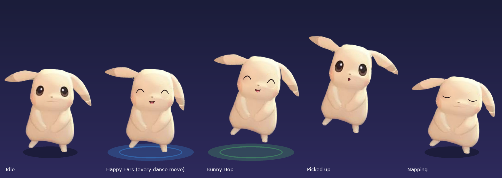
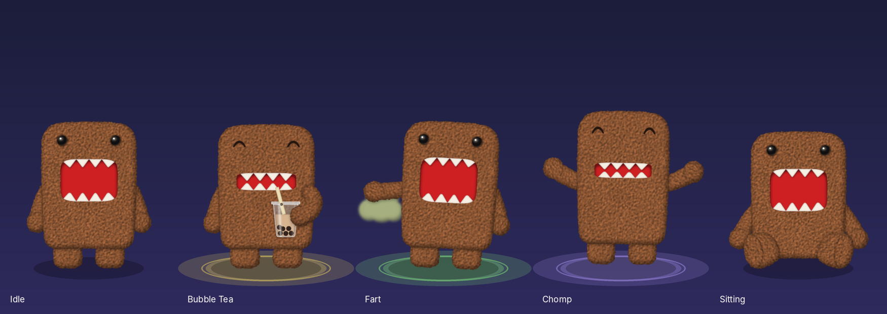
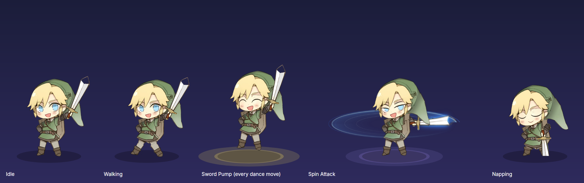

# DeskDancer

A little mate that lives on your desktop and dances. It stands on your taskbar, wanders
about, sits down, naps, and breaks into dance moves on its own or whenever you ask.
Written in C# with [Avalonia](https://avaloniaui.net/); runs on Windows, Linux and macOS.



The mate you start with is **Mochi**. It is an image pack, animated from a single photo.
Standing, it blinks, flicks an ear and tilts its head; it waddles from foot to foot when
it wanders, puts on a happy face and flaps its ears for every dance move, and has two
dances of its own, Bunny Hop and Ear Wave. Its ears swing on springs, so they trail and
flop as it moves. How it was made, and how to change it, is in
[characters/mochi/_source](characters/mochi/_source/README.md).


**Remix** is a DJ robot drawn entirely in code, with arms, legs and a face of its own.


**Lyra**, a bard with a lute, is an image pack animated from a single drawing by
@thaissingarts. She blinks, her long hair sways and swings after her when she moves, and
now and then she waves. She walks on her own two feet and sits down on her heels. When
the music starts she plays her lute, strumming and singing along to every dance move,
and she has three dances of her own: Serenade, Hair Flip and Wave Hello. Pick her under
**Character**, or start with `--character lyra`. How she was made is in
[characters/lyra/_source](characters/lyra/_source/README.md).


**Domo** is an image pack with no picture behind it: a script draws every frame, so his
arms, legs, eyes and mouth all move. He toddles when he wanders, sits down with his legs
out in front of him, snaps his teeth, and has four dances of his own: Chomp, Monster
Stomp, Bubble Tea, where he brings out a cup and drinks it through a straw, and Fart.
How he is drawn, and how to change him, is in
[characters/domo/_source](characters/domo/_source/README.md). Domo is NHK's mascot; this
is a fan drawing, and NHK had no part in it.



**Plush Domo** is the same Domo made of fleece, with felt teeth and glossy beads for
eyes. He is still a flat drawing, and the fleece is made by a script, not taken from a
photo. He does everything Domo does, Bubble Tea and Fart included, because he is drawn
from the same shapes and the same clips by a different painter:
[characters/domo-plush/_source](characters/domo-plush/_source/README.md).


**Piplup** is the quick kind of image pack: one picture and nothing else. It is a fan
drawing by @ros…, taken off its background and stood upright on a level floor. The app
does the rest, so Piplup breathes, waddles, sits, naps and does every dance move, bounced,
leaned, spun and flipped as a whole. Pick it under **Character**, or start with
`--character piplup`. How the picture was prepared is in
[characters/piplup/_source](characters/piplup/_source/README.md). Piplup is a Pokémon and
belongs to Nintendo, Creatures and Game Freak, who had no part in this pack.



**Sprig**, a little swordsman in a green cap, is an image pack animated from a single
commissioned drawing. He blinks, the long tail of his cap swings and flops after him when
he moves, and now and then he gives his sword a flourish. He walks on his own two feet and
kneels with the point of his sword in the ground. He punches the sword up on every beat of
the built-in dance moves, and his special move is the **Spin Attack**: he crouches while
the blade charges up with light, spins round twice leaving a ring of light behind it, and
comes out of it with the sword held high in a shower of sparks. Pick him under
**Character**, or start with `--character sprig`. How he was made is in
[characters/sprig/_source](characters/sprig/_source/README.md). Sprig is fan art of a
Nintendo character, and Nintendo had no part in it.


**Kori** is an ice cube with stubby arms and legs, an original character drawn entirely by
a script, like Domo. It is a real cube turned in three dimensions, so the light moves across
its faces as it turns, with glints, a crack and trapped bubbles in the ice. It blinks,
shivers, drips meltwater, waddles about and sits on a little puddle. It has three dances of
its own: **Ice Skate**, gliding on one foot and spinning on the spot; **Meltdown**, melting
into a puddle and freezing back up with a sparkle; and **Brr!**, shivering until it sneezes
out a puff of frost. Pick it under **Character**, or start with `--character kori`. How it
is drawn, and how to change it, is in [characters/kori/_source](characters/kori/_source/README.md).

Switch between them under **Character** in the menu. You can also drop in a folder of
your own images and it becomes a character that walks and dances too: see
[characters/README.md](characters/README.md).

## Run it

Ready-made downloads for Windows, Linux, macOS and Android are on the
[Releases](https://github.com/FriendlyUser/deskdancer/releases) page. To build it yourself,
you need the [.NET 10 SDK](https://dotnet.microsoft.com/download). The result
is a single self-contained program that needs nothing installed to run.

Windows (PowerShell):

```powershell
.\publish.ps1
dist\win-x64\DeskDancer.exe
```

Linux:

```bash
./publish.sh
dist/linux-x64/DeskDancer
```

macOS:

```bash
./publish.sh
open dist/osx-arm64/DeskDancer.app
```

On a Mac the script builds for the machine it is run on (`osx-arm64` on Apple silicon,
`osx-x64` on Intel) and wraps the result up as an app.

Either script takes a runtime name if you want to build for another system, for example
`./publish.sh win-x64`. Keep the `characters` folder next to the program: Mochi lives in
it, and without it the mate is Remix. In the Mac app it is inside the app itself.

Every push is also built by GitHub Actions. If you would rather not install .NET, open
the latest run under the repository's **Actions** tab and download one of its artifacts:
`DeskDancer-win-x64`, `DeskDancer-linux-x64`, `DeskDancer-osx-arm64` (Macs with Apple
silicon) or `DeskDancer-osx-x64` (Intel Macs).

To run straight from source instead: `dotnet run --project src/DeskDancer`.

## Using it

| Do this | And the mate |
| --- | --- |
| Double-click | starts a random four-move dance (double-click again to stop) |
| Click | does a happy hop |
| Drag | gets picked up; let go and it drops, throw it and it flies |
| Right-click | opens the menu |

The right-click menu has everything else:

- **Dance move / Routine**: pick one of 15 moves or a choreographed routine.
- **Moves to use**: untick the moves you don't care for, built-in ones and the
  character's own. See [Switching moves off](#switching-moves-off) below.
- **Dance party**: every mate on screen dances non-stop, in sync.
- **Tempo**: 80 to 160 BPM. All moves are written against the beat, so they follow it.
- **Sit down / Take a nap**, and switches for wandering, dancing on its own, falling
  when dropped, and the notes-and-sparkles effects.
- **Character / Size / Add another mate**: switch character, resize from 50% to 300%,
  or put several mates on screen at once.
- **Always on top**, **Click through empty space**, **Quit**.

### The moves

Bounce, Sway, Disco Point, Side Step, Shuffle, Wiggle, Headbang, Pop & Lock, Star Jumps,
Twirl, Tornado, Backflip, Cartwheel, Moonwalk and Strut. The last three travel across
the screen. Routines chain them: Disco Fever, Street, Acrobat and Chill.

Every move works on every character. Remix also moves its arms, legs, head and face;
image characters are bounced, leaned, spun and flipped as a whole.

### Switching moves off

Right-click the mate and open **Moves to use**. It lists the character's own dances first,
then the 15 built-in moves, each ticked while it is in use. Untick the ones you don't care
for; the menu stays open, so you can go down the list in one go, and **Switch them all back
on** undoes the lot. A move that is switched off is left out everywhere:

- the **Dance move** list,
- the dance a double-click starts, and the dances a mate does on its own,
- the **Dance party**, even one that is already going,
- **Routines**, which play without it, and disappear from the menu if that leaves nothing.

The built-in moves are shared by every mate. A character's own dances are switched off for
that character alone, so switching off Domo's Fart leaves Plush Domo's alone. One built-in
move always stays on, so there is always something to dance: the last one cannot be
unticked.

The choice is saved with the other settings (see below), in `settings.json` under
`DisabledMoves`. You can also edit it there while the app is closed: a built-in move is
listed by its id, and a character's own dance as the character's folder name and the
clip's name, joined by a slash.

```json
"DisabledMoves": ["backflip", "cartwheel", "tornado", "domo/dance_fart", "sprig/dance_spin_attack"]
```

The ids of the built-in moves are `bounce`, `sway`, `disco`, `sidestep`, `shuffle`,
`wiggle`, `headbang`, `poplock`, `starjump`, `twirl`, `tornado`, `backflip`,
`cartwheel`, `moonwalk` and `strut`. A character's clip names are the names under
`clips` in its `character.json`, or, if it has none, its file names without the
extension, such as `dance_spin_attack`.

## Platform notes

**Windows 10 and 11.** Nothing to set up.

**Linux.** Needs an X11 session, or Wayland with XWayland (the default on GNOME and
KDE), and a compositing window manager for the transparent background. Without a
compositor the mate appears on a black rectangle.

**macOS.** Macs with Apple silicon or Intel, on macOS 12 or later. The download unzips
to `DeskDancer.app`. It is not signed with an Apple developer ID, so the first time
macOS will say it cannot check the app. Open **System Settings > Privacy & Security**,
scroll down and choose **Open Anyway** (on macOS 14 and earlier, right-clicking the app
and choosing **Open** works too), or clear the download flag from a terminal:

```bash
xattr -dr com.apple.quarantine DeskDancer.app
```

An app you build yourself has no such flag and just opens. DeskDancer shows in the Dock
while it runs; quit from there or from the mate's menu. The mate stands on the Dock, or
on the bottom of the screen if the Dock is hidden or at the side.

**Android (prototype).** Android 8 or later. Each release has an APK for installing by
hand rather than from a store, and the `android` workflow builds one for every change
(the `DeskDancer-android` artifact of a run). Open the APK on the phone and allow
installing from that app when Android asks. In DeskDancer, tap **Allow display over other
apps** and switch it on; on recent Android versions a sideloaded app may first need
**Allow restricted settings** from its App info page. Then put the mate on the screen.
It stands on the navigation bar over whatever app is open. Drag it to carry and throw
it, double-tap it to dance, and long-press it for the settings. A notification stays up
while it is out, because Android only keeps an app on the screen that way; it has Dance
and Put away buttons. The APK carries Mochi and Remix; other packs are one line each in
`src/DeskDancer.Android/DeskDancer.Android.csproj`. Touches around the mate go to the app
underneath, which on Android 12 and later means the mate is drawn slightly see-through,
as Android requires of anything that lets touches pass. Tick **Solid mate** in the
settings to draw it at full strength instead; taps right around it then stop reaching
the app underneath.

**Clicking through.** The mate lives in a small transparent window. So that the empty
part of it does not block what is underneath, only the area around the character
takes mouse input. On Windows this is done while the mate is standing, sitting or
walking; during a dance the whole window (roughly 1.7 x 2 character heights) takes
clicks. On macOS a window either takes the mouse or ignores it altogether, so the mate's
window is switched from one to the other as the pointer moves on and off the character.
Turn the feature off in the menu if it misbehaves with your setup.

Settings are remembered in `%APPDATA%\DeskDancer` on Windows, `~/.config/DeskDancer` on
Linux and `~/Library/Application Support/DeskDancer` on macOS, along with a log file if
something goes wrong. That includes which character each mate is, so a mate you already
have stays as it was when the program is updated.

## Command line

```
--character <id>        Start with this character: "builtin" for Remix, or a folder
                        name such as "mochi"
--characters <folder>   Also look for character folders here
--fresh                 Ignore saved settings for this run
--smoke-test            Run every feature for a few seconds, exit 0 on success
--render-test <dir>     Render every dance move to PNG contact sheets
--export-sample <dir>   Write the built-in character out as an example image pack
```

## How it is put together

```
src/DeskDancer/
  Engine/       Behaviour and choreography. No UI code in here.
    DanceMoves.cs   Each move is a function from "beats elapsed" to a pose
    MateBrain.cs    Idle / walk / sit / sleep / dance / drag / fall state machine
    Conductor.cs    Beat clock and the shared session behind the dance party
  Characters/   Remix (drawn in code) and the loader for image packs
  Ui/           The transparent window, its menu and the renderer
  Platform/     Click-through for Windows, X11 and macOS; getting freed memory back on Linux
  Tools/        Smoke test, contact sheets and the example pack exporter
src/DeskDancer.Android/
                The Android app: the same engine, characters and renderer, compiled in
                from src/DeskDancer and drawn in an overlay window kept up by a service
characters/     Character packs that ship with the app
packaging/      What macOS needs in order to treat the build as an app
```

An image pack is not read all at once. Its idle animation is read when the character is
picked, which at start-up happens on another thread while the window is being put
together. Each of its other animations is read the first time the mate needs it, and
dropped again after a minute out of use. A mate that mostly stands about holds little
more than its idle frames.

The GitHub Actions workflow builds for Windows, Linux and both kinds of Mac, and runs
the smoke test on each. The smoke test starts the real app and drives it: dancing, a
two-mate party, the menu, dragging and throwing, with Mochi, Remix and the example pack
each taking a turn. It switches off every move but one and checks that the mate, the
party, the routines and the menu offer that one alone. It checks that a pack holds only
the animations its mates have shown, that they come back after being taken away, and
that every animation of every pack can be read. On Windows and macOS it also reads
pixels back off the screen to confirm that the window is see-through and the character
is visible, checks that clicks pass through the empty part of the window, and saves
pictures of the desktop as artifacts. On macOS, where what a click lands on depends on
where the pointer is, it moves the pointer onto the mate, off onto the empty corner of
its window and back again, and asks the system each time.

A second workflow, `android`, builds the APK and runs it on an Android 14 emulator. It
grants the overlay permission, puts Mochi on the home screen, makes it dance and drags it
with a scripted swipe, then compares screenshots with one of the bare home screen: the
mate has to be visible, the stage around it has to be see-through, the dancing frames have
to differ, and the drag has to reach the mate. The screenshots are saved as artifacts, and
a rough outline of what appeared on the screen is printed in the job's log.

### Making a release

Set `<Version>` in `src/DeskDancer/DeskDancer.csproj` to the new number, then on GitHub open
**Actions > release > Run workflow**, pick `main` and give the same number, like `1.0.0`. The
workflow builds and tests every platform exactly as the two workflows above do, then
publishes release `v1.0.0` on that commit with a download for each platform.

**Signing the Android app.** Android only installs a new version of an app over the old one
when both are signed with the same key. Without a key of the repository's own, each build
is signed with a key made up for it, so a newer APK has to replace the old one by
uninstalling it first. To sign every release with one key, make it once and keep it safe:

```bash
keytool -genkeypair -v -keystore deskdancer.keystore -alias deskdancer -keyalg RSA -keysize 4096 -validity 10000
```

Then add four repository secrets under **Settings > Secrets and variables > Actions**:
`ANDROID_KEYSTORE_BASE64` (the output of `base64 -w0 deskdancer.keystore`),
`ANDROID_KEYSTORE_PASSWORD`, `ANDROID_KEY_ALIAS` (`deskdancer` above) and
`ANDROID_KEY_PASSWORD`. Losing the key means the next release cannot install over the
last, so keep a copy somewhere other than GitHub.

One thing to know when building: Avalonia's build step sends anonymous usage data to
its vendor. The publish scripts and the workflow switch that off with
`AVALONIA_TELEMETRY_OPTOUT=1`; set it yourself if you build some other way.
